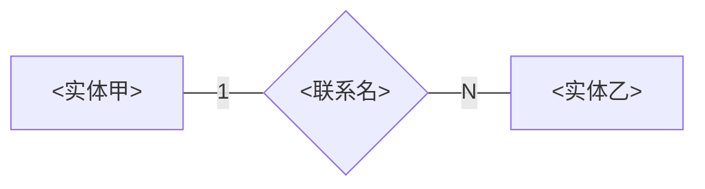

# Entity-relationship diagram

Follow Chen’s description of the 1976 diagram: entity types are rectangles, relationship types
are diamonds, and 1 or N on a line is the upper limit of that entity’s participation.
<https://bit.csc.lsu.edu/~chen/pdf/Chen_Pioneers.pdf>

Attributes stay in [table](table.md). This figure shows entities, relationships, and limits.
The paragraph names the columns that implement each relationship. A quantity that depends on
both entities is an attribute of the relationship, as Chen does with PERCENTAGE-OF-TIME on
PROJECT-WORKER.

The 1 sits on the side whose upper limit is one. The N sits on the side whose upper limit is
many.

## 联系

<实体甲>参与「<联系名>」的上限是 1，<实体乙>参与「<联系名>」的上限是 N。<一句说清谁可以对应多条谁。>`<表乙>.<列>` 引用 `<表甲>.<列>`。见 `<路径>`。

Draw every relationship the inventoried files define. When the question names one relationship,
draw that one.
