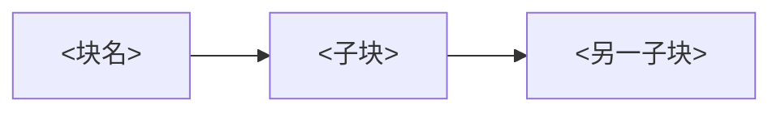

# A repeated block and the one exception

Follow Xiaomi LLM-Core, “MiMo-V2-Flash Technical Report”, arXiv:2601.02780, section 2.1 and
Figure 2. <https://mimo.xiaomi.com/papers/mimo-v2-flash.pdf>

The caption carries the counts: “The model comprises M = 8 Hybrid Blocks, where each Hybrid
Block interleaves N = 5 Sliding Window Attention (SWA) blocks with one Global Attention (GA)
block.” The paragraph states the exception: “The only exception is the very first Transformer
block, which uses global attention with a dense Feed-Forward Network (FFN).”

Boxes stay short names. Put the repeat count and the exception in the caption and the
paragraph. Cite the file that fixes the count.

## 重复结构

<系统名>由 <M> 个<块名>组成，如图 1。每个<块名>里有 <N> 个<子块>，然后是一个<另一子块>。唯一的例外是<哪一个>：它<例外是什么>。见 `<路径>`。图题写上数量和例外。
