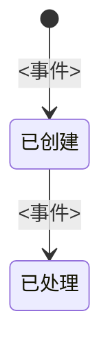

# Status after an event

Follow RFC 9293, “Transmission Control Protocol (TCP)”, the connection state diagram.
<https://datatracker.ietf.org/doc/html/rfc9293>

“A TCP connection progresses from one state to another in response to events.” “The state
diagram in Figure 5 illustrates only state changes, together with the causing events and
resulting actions.” A node is the value stored after the write. The edge is the event that
causes that write.

Name the column. One sentence per state says what that value means, in the manner of RFC 9293’s
“represents waiting for…”. Draw one diagram per stored status column, and walk every transition
that writes that column. Leave a failure that does not change the column out of the figure, cite
the file that handles it, and say so in the last sentence.

## 状态

<记录名>的状态记在 `<表>.<列>`。见 `<路径>`。<第一状态>表示<此时什么已经发生、什么尚未发生>。<事件>之后，该列改为<下一状态>。写入位置见 `<路径>`。

Use the status strings stored by the program. Do not invent a state the column never receives.
